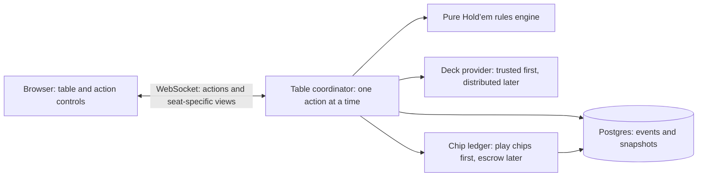

# Capped Texas Hold’em — initial design

**Recommendation:** Build an invite-only browser table with non-redeemable play chips, a rotating dealer button, fixed blinds, and between-hand rebuys. Keep the Hold’em rules engine independent of the server, the deck provider, and the chip ledger. Prototype decentralized dealing and settlement with test assets after the table works. The first playable version has a trusted operator; the eventual decentralization target is that no one operator can see everyone’s cards, dictate payouts, or block withdrawals indefinitely.

## Table and hand

| Decision | First playable version |
| --- | --- |
| Table | 2–6 seats, private room code, cash-table format with fixed blinds and no tournament elimination |
| Default stakes | 2-chip small blind, 5-chip big blind, 500-chip initial buy-in; settings fixed for each hand |
| Dealer | The button marks player position and rotates between hands. Software deals. The room host can invite players and configure a new table, but gets the same card visibility as every other player. |
| Actions | Check, fold, call, bet, raise, and all-in when legal. Display the exact chip amount to add, the target total for raises, and the street ceiling. |
| Turn order | With 3+ players, blinds are immediately clockwise of the button; action starts after the big blind preflop and after the button postflop. Heads-up, the button posts the small blind and acts first preflop and last postflop. |
| Timeout | Check if legal, otherwise fold. A reconnect restores the same seat and private cards while the clock continues. |
| Buy-in and rebuy | A buy-in seats a player with 500 chips. A rebuy is an explicit, one-click request once a settled hand leaves the player with zero chips. It restores the default stack before the next deal. The player sits out until funded. No mid-hand reloads, loans, automatic purchases, or chip top-ups in v1. |

Each seat gets two private cards. Play progresses through preflop, flop, turn, and river. If everyone but one player folds, award the pot without showing the winner’s cards. If betting is complete and fewer than two live players can wager further, run out the remaining board. At showdown, rank the best five of each eligible player’s seven cards. Split tied pots and award any odd chip to the first tied winner clockwise from the button. Folded chips stay in the pot; folded players cannot win. Return any uncalled excess. For example, commitments of 30, 80, and 80 make a 90-chip main pot and a 100-chip side pot contested by the two 80-chip contributors, assuming all three are still live.

Sources for the baseline mechanics: [PokerStars Hold’em rules](https://www.pokerstars.com/poker/games/texas-holdem/) and [Poker TDA rules on position, raises, and reopening action](https://www.pokertda.com/view-poker-tda-rules/). Use the TDA as a reference for edge cases; the multiplier structure below is a custom cash-table rule.

## Betting: multiplier buttons plus a hard street ceiling

**A raise target is the player’s total contribution on this street.** If the current wager is 20 and the player has already put in 5, calling costs 15. Raising to 40 costs 35. No player can commit more than their available stack.

There are two separate numbers:

- **Current wager:** The amount a player must match to call, including a short all-in that increases it. The 1× button is a call, and the regular raise candidates are 2×, 4×, and 8× the current wager.
- **Street ceiling:** The maximum contribution per player on that street. Preflop it is 8× the nominal big blind. On the flop, turn, and river it is 8× the opening bet, set once when that street first sees a wager (use the big blind as the base if a short all-in opens for less). Reset the ceiling at the next street. The ceiling applies to all-ins too.

When no bet is open postflop, allow check or an opening bet of 1×, 2×, 4×, or 8× the big blind. A player with less than one big blind may open all-in. Before a full postflop opening bet exists, a player who is next to act can complete a short opener to one big blind or choose a larger legal opening size from the same presets. The full opening amount sets the first minimum raise increment and reopens action for players who called the short wager. The ceiling stays fixed. Preflop, use the full nominal big blind for the opening target and minimum raise increment even if it was posted short, whenever two or more live players can still bet. If only one can bet, settle any outstanding call to actual opposing wagers before running out the board.

| With a 5-chip big blind | Current wager | Legal buttons, assuming sufficient stacks and open action |
| --- | ---: | --- |
| Flop: A opens for 20; street ceiling locks at 160 | 20 | Call 20; raise to 40, 80, or 160; fold |
| B raises to 80; the ceiling stays at 160 | 80 | Call 80; raise to 160; fold |
| C raises to 160 | 160 | Call 160 or fold |
| Alternative: after 80, C shoves short to 100 | 100 | Call 100 or fold. The first preset raise is 200, above the ceiling; no custom-size raise to 160. |

For an ordinary raise, require a listed target, a player who is eligible to raise, at least one other live player who can contest the raise, and a target between the minimum and the lesser of the ceiling and the player’s stack plus their existing street contribution. The minimum target is the current wager plus the last full bet or raise increment. For example, after 20 → 80 the last full raise was 60, so a shove to 100 is only a 20-chip increase. A short all-in can call for less, or raise below the ordinary minimum when the player is eligible to raise and its total remains within the ceiling. A full-size all-in must land on a legal preset. A single short raise generally does not reopen action for someone who has already acted; cumulative short raises can reopen action for that player once they face at least a full increment. Reopening action does not create a legal raise if all presets still exceed the ceiling.

The default allows up to 64 big blinds on one postflop street if the opener bets 8 big blinds. If that is too high in playtests, add a table-wide limit in big blinds and take the lower of that limit and the opening-bet ceiling. The starting stack and rebuy policy control a different part of exposure. Publish these rules before players sit. If playtests show too few raises after short all-ins, try a fixed ladder tied to the opening bet as a separate table mode rather than silently adding custom amounts.

## Architecture and stack

| Layer | Recommended stack | Why |
| --- | --- | --- |
| Browser | React, TypeScript, [Vite](https://vite.dev/guide/) | Render the table and legal actions from the server's wire protocol. |
| Real-time server | Go, `net/http`, [coder/websocket](https://github.com/coder/websocket) | Give each active table one goroutine that processes commands in order. Independent tables can run concurrently. |
| Engine | Pure Go package, integer chip units, pinned rule versions | Validate actions, calculate pots, and score showdowns deterministically. The coordinator supplies decks and timeout events. |
| Persistence | [PostgreSQL](https://www.postgresql.org/docs/current/explicit-locking.html) with [pgx](https://github.com/jackc/pgx) | Commit table events, snapshots, and ledger entries together. Start with a single server process. |
| Verification | Go tests, fuzzing, race detector, and Playwright | Cover poker rules, table lifecycle, and multi-browser reconnects. |
| Settlement experiment | Solidity, Foundry, [go-ethereum](https://geth.ethereum.org/docs/developers/dapp-developer/native-bindings-v2), and viem on one EVM L2 testnet | The Go service reads escrow events and the browser wallet signs balance checkpoints. Choose the network after measuring finality, fees, and wallet UX. |

The browser sends an intent such as `raiseTo(80)` with the table, hand, expected state version, and unique action ID. The coordinator authenticates the seat, validates the action and deadline, persists the next state and chip movements, then acknowledges and publishes the update. Reject stale or out-of-turn actions; repeated IDs return the original result. On reconnect or server restart, resume from persisted state with the same deadline and deck, or follow a defined void-and-refund rule if the hand cannot be recovered. Key records: table configuration and seats; hand and street state; per-seat commitments and last action; private deck state; ordered events; ledger entries. Keep secrets out of public replay data.

The play-chip dealer shuffles using a cryptographically secure random generator and an unbiased Fisher–Yates shuffle. Keep the deck and private hole cards out of shared room messages and routine logs. Send each player's private view only to their authenticated connection and derive it again on reconnect. A deck commitment can bind the operator to its choice. Honest shuffle selection and private dealing require separate mechanisms. Publishing the full seed would reveal the deck, including folded cards.

## What to decentralize

| Model | What it gives us | What remains trusted |
| --- | --- | --- |
| Play-chip beta | A working table, deterministic rules, and replayable public actions | The operator deals cards, records outcomes, and manages play chips. |
| Hybrid testnet | Deposits and withdrawals via escrow; off-chain turns; settlement from player-signed balance checkpoints | The dealer still sees the deck. Checkpoints prove consent to balances, not that an unsigned hand was scored correctly. |
| Operator-independent target | Independently operated participants verify an encrypted shuffle and reveal cards selectively; settlement verifies agreed or provable outcomes | The protocol needs explicit assumptions about participant collusion, offline players, and who can produce and verify a dispute proof. A relay may still coordinate messages. |

In the hybrid proof of concept, use a fixed roster per test session. After each hand, obtain every participant’s signature over the same balance checkpoint. Include table and session IDs, monotonically increasing sequence, rules version, balances and an agreed transcript digest in the signed data, with the chain and contract in the [EIP-712 domain](https://eips.ethereum.org/EIPS/eip-712). Make the full signed checkpoint available to every participant before dealing again. The contract checks the roster, signatures, sequence, and conservation of the escrowed balance. Anyone in the session should be able to initiate an exit and submit a checkpoint. Allow a newer signed checkpoint to supersede a stale one during a challenge window, and allow participants to withdraw once the window closes. If someone refuses to sign, stop dealing and fall back to the last agreed checkpoint, or initial balances if no hand was agreed. That can discard an unsigned result, giving a losing player a reason to withhold a signature. This is a core design problem to solve before value is at stake. Keep deposits and rebuys outside active hands; in the testnet experiment a rebuy changes funding between sessions, after the prior session closes.

For distributed dealing, prototype *mental poker*: participants re-encrypt and shuffle an encrypted deck with proofs, then release only the information needed for each private card, public board card, or showdown reveal. See [Groth’s verifiable secret shuffle paper](https://eprint.iacr.org/2005/246). Test how a deal proceeds or aborts if someone refuses to reveal a share. Avoid publishing private cards, deck seeds, or decryption keys to a public chain. A public chain can settle transfers; it does not make ordinary public contract state private. [Ethereum’s state channel overview](https://ethereum.org/developers/docs/scaling/state-channels/) explains the trade-off between off-chain interaction, signed updates, and on-chain disputes.

## Build order and acceptance checks

1. **Local rules engine.** Simulate full hands from a fixed test deck. Cover heads-up button/blinds, short blinds, the exact 20 → 80 → 160 sequence, cumulative short all-ins, ties, refunds, side pots, and zero-stack rebuys. Verify no duplicate cards, no negative balances, and no chip creation or loss within a hand.
2. **Playable browser table.** Start a private table, finish a hand from two browsers, test a multiway side pot, time out a turn, reconnect without leaking cards, and rebuy once after busting. Verify the UI and engine agree on legal actions, duplicate requests cannot debit twice, and a restart does not change an already dealt hand.
3. **Decentralization prototypes.** Exercise escrow exits with a missing signer and a stale checkpoint on testnet; separately benchmark a private verifiable deal with a missing shuffle/decryption participant. Decide on the trust, dispute, and recovery model from the results.

The first release uses chips with no monetary value or redemption. If the product later takes real stakes, choose the launch markets before designing deposits, and make legal review and independent security review release gates. The multiplier rule does not replace responsible play controls or address player collusion.
